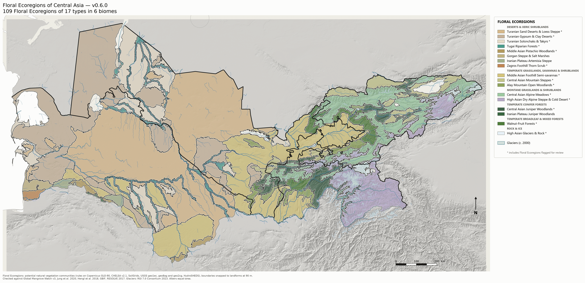
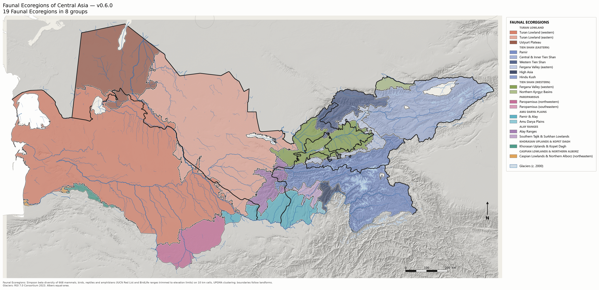
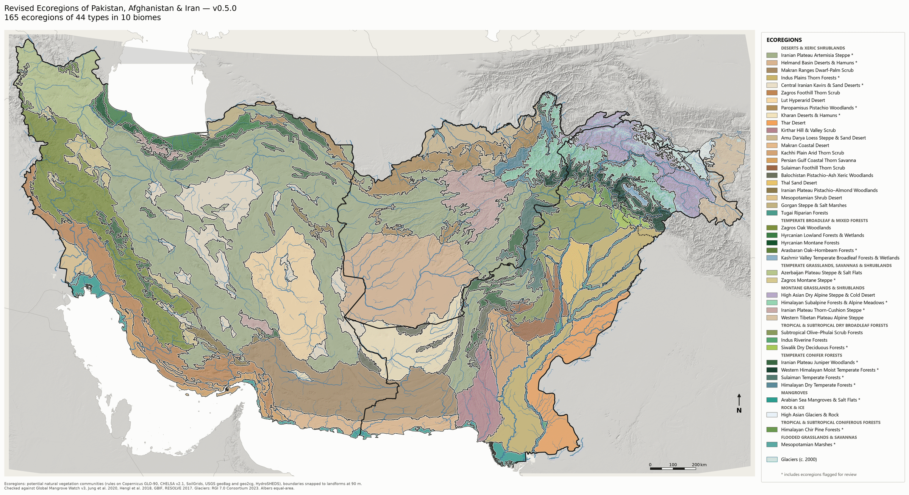
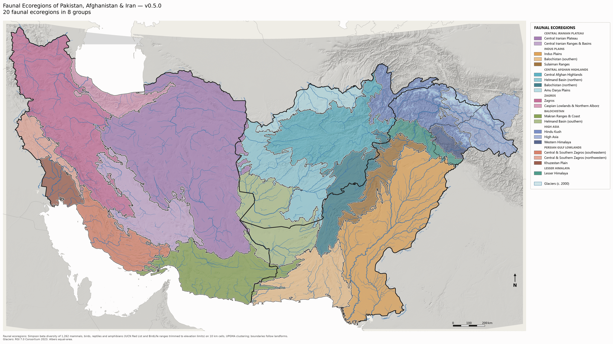
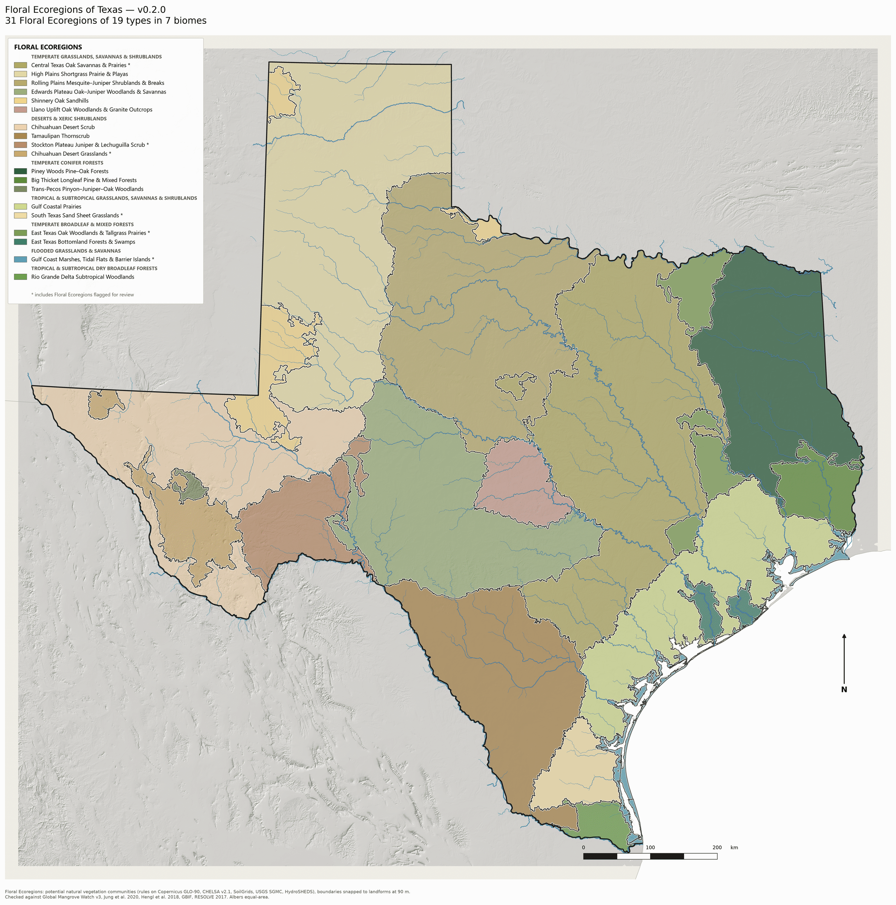
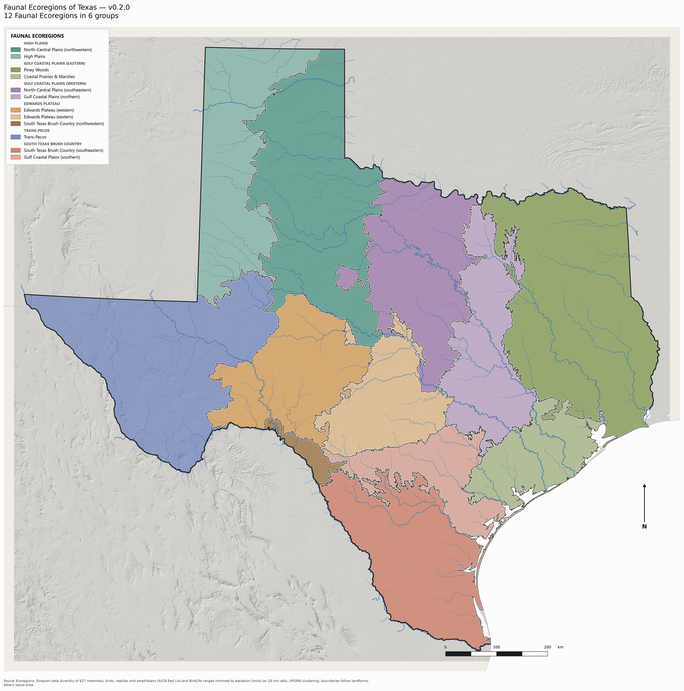

# Revised Ecoregions of the World

A new ecoregion map of the world, built to improve on the WWF/RESOLVE *Ecoregions 2017* map. Each area is mapped
with the same method and published when it is finished. Every area has two maps:

- **Floral Ecoregions**: regions of distinct natural vegetation.
- **Faunal Ecoregions**: regions of distinct mammals, birds, reptiles and amphibians.

## Progress

| Area | Version | Land area | Floral Ecoregions | Types | Faunal Ecoregions | Maps |
|---|---|---|---|---|---|---|
| Turkmenistan, Uzbekistan, Tajikistan & Kyrgyzstan | 0.6.0 | 1,240,537 km² | 109 | 17 | 19 | [floral](outputs/central-asia/ecoregions_map_v0.6.0.png) · [faunal](outputs/central-asia/faunal_map_v0.6.0.png) |
| Pakistan, Afghanistan & Iran | 0.5.0 | 3,281,449 km² | 165 | 44 | 20 | [floral](outputs/pak-afg-irn/ecoregions_map_v0.5.0.png) · [faunal](outputs/pak-afg-irn/faunal_map_v0.5.0.png) |
| Texas | 0.2.0 | 685,641 km² | 31 | 19 | 12 | [floral](outputs/texas/ecoregions_map_v0.2.0.png) · [faunal](outputs/texas/faunal_map_v0.2.0.png) |
| **Total** | | **5,207,627 km²** | **305** | | | **3.5 % of the world's land** |

Next: Central Asia.

| Date | Done |
|---|---|
| 2026-11-06 | Pakistan (v0.2.0) |
| 2026-11-08 | Kashmir (v0.3.0) |
| 2026-11-09 | Afghanistan (v0.4.0) |
| 2026-11-11 | Pakistan & Afghanistan v0.4.2; Texas v0.1.0 |
| 2026-11-12 | Texas v0.2.0 |
| 2026-11-13 | Pakistan, Afghanistan & Iran v0.5.0, with the first confirmation test |
| 2026-11-14 | Turkmenistan, Uzbekistan, Tajikistan & Kyrgyzstan (v0.6.0), the first area built as a parcel and joined at its border |

## How the maps are made

**Floral Ecoregions.** Natural vegetation communities are mapped at 90 m resolution from explicit rules on terrain,
climate, soils, geology and water ([`communities.yaml`](communities.yaml)). Communities are grouped into types, and
each Floral Ecoregion is one continuous area of one type, with boundaries following landforms. Each type is assigned
a biome.

**Faunal Ecoregions.** Areas with distinct animal communities, grouped from IUCN and BirdLife range maps of mammals,
birds, reptiles and amphibians on 10 km cells.

**Testing.** The maps are compared with RESOLVE on how well they predict the species recorded in GBIF at places not
used to build them. Half the sample cells are held out for this. Because those held-out results were looked at
during development, they count as exploratory. A stricter test uses records sealed before work on an area begins and
opened once, after the map is frozen; its rules are fixed in advance in
[`docs/preregistration.md`](docs/preregistration.md). Every analysis is listed in [`docs/ledger.md`](docs/ledger.md).

Results below are the change in prediction error relative to RESOLVE (positive: ours better), with 95 % intervals.

## Turkmenistan, Uzbekistan, Tajikistan & Kyrgyzstan (v0.6.0)

[](outputs/central-asia/ecoregions_map_v0.6.0.png)

[](outputs/central-asia/faunal_map_v0.6.0.png)

Built on its own with a 75 km strip into Afghanistan and Iran for context, then clipped at the border, so the
Pakistan, Afghanistan & Iran map is unchanged. The Turan lowland divides into the Karakum and Kyzylkum sand deserts,
the Ustyurt gypsum desert, solonchaks and takyrs, and tugai forest along the rivers; the foothills from the Kopet Dagh
to the Fergana Valley are semi-savanna on loess; the Tien Shan and Pamir-Alay rise through walnut-fruit forest,
juniper woodland, spruce forest and mountain steppe to alpine meadow and cold desert.

| Exploratory (held-out cells) | Ours vs RESOLVE |
|---|---|
| Plants, Floral Ecoregions (0.25° / 0.125° cells) | +0.5 % (−0.1 to +1.0) / +0.9 % (+0.3 to +1.5) |
| Birds, Faunal Ecoregions | −1.0 % (−2.1 to −0.1) |

| Confirmation (sealed records, opened once) | Result |
|---|---|
| Plants | Descriptive only (16–19 blocks, 20 needed): +0.3 % (−0.2 to +0.8) at 0.25°, +0.8 % (+0.1 to +1.6) at 0.125° |
| Birds | Descriptive only (18 blocks): Floral Ecoregions −2.4 % (−4.0 to −0.6), Faunal Ecoregions −0.7 % (−1.6 to +0.2) |

The sealed squares held fewer usable records than their raw counts suggested, so no result reached a verdict; the
count check now keeps a margin. As in Iran, plants favour the Floral Ecoregions slightly and birds do not: the
Floral Ecoregions are finer than the bird data can resolve. Most Floral Ecoregions here have too few plant records
to test one by one (25,540 records over 1.24 million km²).

## Pakistan, Afghanistan & Iran (v0.5.0)

[](outputs/pak-afg-irn/ecoregions_map_v0.5.0.png)

[](outputs/pak-afg-irn/faunal_map_v0.5.0.png)

| Exploratory (held-out cells) | Ours vs RESOLVE |
|---|---|
| Plants, Floral Ecoregions (0.25° / 0.125° cells) | +0.2 % (−0.3 to +0.6) / +1.2 % (+0.4 to +1.9) |
| Birds, Faunal Ecoregions | +1.3 % (+0.4 to +2.3) |

| Confirmation (sealed Iranian records, opened once) | Result |
|---|---|
| Birds | Not demonstrated: Floral Ecoregions −2.9 % (−4.6 to −1.6), Faunal Ecoregions −0.9 % (−3.4 to +1.0) |
| Plants | Not testable: too few sealed records |
| Vegetation plots (sPlotOpen) | Too few for a verdict; biome agreement 94 % vs RESOLVE's 54 % |

The gain seen on held-out cells did not hold up for birds on the sealed records. A follow-up analysis found that the
Floral Ecoregions are finer than the bird data can support (they reach parity with RESOLVE at RESOLVE's level of
detail), and that the Faunal Ecoregions are level with RESOLVE.

## Texas (v0.2.0)

[](outputs/texas/ecoregions_map_v0.2.0.png)

[](outputs/texas/faunal_map_v0.2.0.png)

| Exploratory (held-out cells) | Ours vs RESOLVE |
|---|---|
| Plants, Floral Ecoregions (0.25° / 0.125° cells) | −0.4 % (−0.8 to 0.0) / 0.0 % (−0.5 to +0.5) |
| Birds, Faunal Ecoregions | 0.0 % (−1.0 to +0.9) |

At two to three times RESOLVE's detail, the Floral Ecoregions predict plant records as well as RESOLVE. They agree
with the EPA ecoregions with a V-measure of 0.66 (Level III) and 0.64 (Level IV). A test on vegetation plots had too
few plots for a verdict.

## Outputs

Each area's files are in `outputs/<area>/` (larger GeoPackages are zipped). The older Pakistan & Afghanistan v0.4.2
files are in `outputs/`.

| File | Contents |
|---|---|
| `ecoregions.gpkg` | Floral Ecoregions, their types, Faunal Ecoregions, biomes, borders, rivers (Albers equal-area) |
| `ecoregions.csv` | attributes of each Floral Ecoregion: type, biome, Faunal Ecoregion, area, elevation, climate, population, land converted, countries |
| `ecoregions_map_v*.png`, `faunal_map_v*.png` | maps of the Floral and Faunal Ecoregions |
| `physiographic.gpkg`, `physiographic_map_v*.png` | the landform units the Floral Ecoregion boundaries follow |
| `scorecard*.csv`, `confirmation*.csv`, `validation_*.csv`, `ecoregion_audit.csv` | test results and the per-ecoregion audit |

## How to run

```bash
pip install -r requirements.txt && pip install -e .
make all REGION=pak-afg-irn  # one area end to end
python -m ecoregions --region texas <stage>   # one stage (settings in regions/<area>.yaml)
make test
```

On Windows without `make`: `bash scripts/build_all.sh` from Git Bash. Raw downloads are cached in
`data/raw/` (never committed: several are licensed for non-commercial use only).

## Data sources

| Data | Use | Citation | Licence |
|---|---|---|---|
| Copernicus GLO-90 DEM | terrain, hydrology | © DLR e.V. 2010–2014 and © Airbus Defence and Space GmbH 2014–2018, provided under COPERNICUS by the European Union and ESA | Copernicus DEM licence |
| HydroRIVERS v1.0, HydroBASINS v1c | rivers, basins | Lehner & Grill 2013, *Hydrol. Process.* 27: 2171–2186 | CC BY 4.0 |
| CHELSA v2.1 (1981–2010) | climate | Karger et al. 2017, *Sci. Data* 4: 170122 | EnviDat open terms |
| SoilGrids 2.0 | soils | Poggio et al. 2021, *SOIL* 7: 217–240 | CC BY 4.0 |
| Geologic maps of South Asia (geo8ag), Iran (geo2cg) and the former Soviet Union (geo1ec) | geology | Wandrey & Law 1998, USGS OFR 97-470-C; USGS OFR 97-470-G; USGS OFR 97-470-E, doi:10.5066/P9GUL0PQ | public domain |
| USGS State Geologic Map Compilation | geology (Texas) | Horton 2017, doi:10.5066/F7WH2N65 | public domain |
| ESA WorldCover 2021 | land converted | Zanaga et al. 2022, doi:10.5281/zenodo.7254221 | CC BY 4.0 |
| GHS-POP R2023A (2020) | population | Schiavina et al. 2023, JRC | CC BY 4.0 |
| IUCN Red List range maps and assessments | Faunal Ecoregions | IUCN 2026, *The IUCN Red List of Threatened Species* | IUCN terms (non-commercial) |
| BirdLife bird distribution maps 2025 | Faunal Ecoregions | BirdLife International and Handbook of the Birds of the World 2025 | BirdLife terms (non-commercial) |
| EltonTraits 1.0 | body mass for the megafauna lists | Wilman et al. 2014, *Ecology* 95: 2027, doi:10.6084/m9.figshare.3559887 | CC0 |
| GBIF occurrence downloads | testing, audit | GBIF.org 2026, doi:10.15468/dl.22b9a4, doi:10.15468/dl.6t43nn, doi:10.15468/dl.gv4z7m, doi:10.15468/dl.u2kux5, doi:10.15468/dl.77g6hc | per record; only aggregates stored |
| RESOLVE Ecoregions 2017 | biomes, comparison | Dinerstein et al. 2017, *BioScience* 67: 534–545 | CC BY 4.0 |
| EPA Level III and IV ecoregions | comparison only (Texas) | Griffith et al. 2007, *Ecoregions of Texas*, U.S. EPA | public domain |
| Jung et al. 2020 habitat map; Hengl et al. 2018 potential natural vegetation | checks of the vegetation rules | Jung et al. 2020, *Sci. Data* 7: 220; Hengl et al. 2018, *PeerJ* 6: e5457 | CC BY 4.0 |
| WhiteboxTools | geomorphons | Lindsay 2016, *Comput. Geosci.* 95: 75–84 | MIT |
| Global Mangrove Watch v3 | check of the mangrove rules | Bunting et al. 2022, *Remote Sens.* 14: 3657 | CC BY 4.0 |
| RGI 7.0 | glaciers | RGI 7.0 Consortium 2023, doi:10.5067/f6jmovy5navz | public |
| Natural Earth 10 m | boundaries | naturalearthdata.com | public domain |

## Licence and ownership

Copyright © 2026 Asas Husain. All rights not granted below are reserved.

* **Code** (`src/`, `tests/`, the rule files and configuration): [PolyForm Noncommercial
  1.0.0](LICENSE). Anyone may use, copy and change it for non-commercial purposes (research,
  teaching, personal study, public-interest organisations) and must pass on the line beginning
  `Required Notice:` in `LICENSE`. Any commercial use needs a separate written licence from the author.
* **Maps and derived data** (`outputs/`, the static maps): [CC BY-NC
  4.0](https://creativecommons.org/licenses/by-nc/4.0/). Credit: "Husain, A. (2026) Revised
  Ecoregions of the World: <area>, vX.Y.Z. https://github.com/AsasHusain/Ecoregions", plus
  the source attributions above. No commercial use without written permission.
* **Third-party material keeps its own terms.** The source datasets are cited above and their raw files are never redistributed. Several (IUCN and BirdLife ranges,
  some GBIF records) are licensed for non-commercial use only, which the derived products inherit.
* **Commercial licensing and permissions:** contact the author through GitHub (@AsasHusain).
* Versions released before this change (up to commit c5ab452, November 2026) were published
  under MIT and remain so for anyone who obtained them then; this licence applies from v0.4.1.
