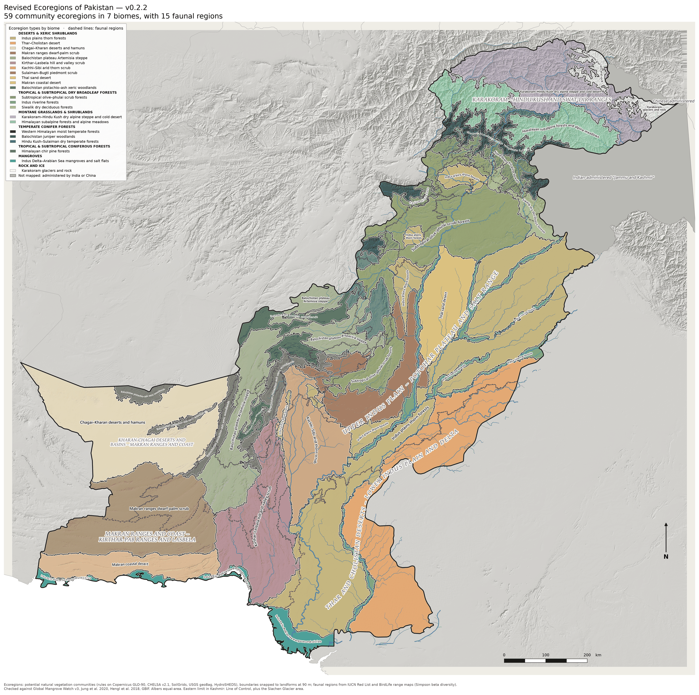

# The New Ecoregions of Pakistan (v0.2.2)

Biodiversity-based ecoregions for Pakistan, Azad Kashmir, Gilgit-Baltistan and
the Siachen Glacier area, replacing the coarse WWF/RESOLVE *Ecoregions2017*
units (where "Aravalli West Thorn Scrub Forests" covers most of the Indus plain)
with ecoregions built from natural communities and species turnover:

| Level | What it is | How it is made | Count |
|---|---|---|---|
| **Biomes** | RESOLVE biome of each ecoregion type | from the ecoregion types | 7 |
| **Faunal regions** (overlay) | Areas with distinct vertebrate assemblages | Simpson beta diversity of 849 mammals, birds, reptiles and amphibians (IUCN Red List and BirdLife ranges trimmed to elevation limits) on 10 km cells, UPGMA clustering; boundaries follow the physiographic units. An overlay: faunal boundaries do not cut ecoregions | 15 |
| **Ecoregions** | Mappable areas of one natural community type — the main deliverable | 38 potential natural vegetation communities mapped at 90 m by explicit rules ([`communities.yaml`](communities.yaml)), grouped into 22 ecoregion types; each ecoregion is one continuous area of one type (not cut by faunal regions, provinces or borders inside the study area), minimum 1,000 km², boundaries snapped to landforms | 59 |

[](outputs/ecoregions_map_v0.2.2.png)

*Click the map for the full-resolution version.* Companion layer: the
physiographic regionalization (17 provinces, 389 units) —
[map](outputs/physiographic_map_v0.2.2.png), described below.

> Political boundaries: the study area ends at the Line of Control and includes the Siachen Glacier area; other areas administered by India or China are shown flat gray.

**Outputs** (`outputs/`)

| File | Contents |
|---|---|
| `ecoregions.gpkg` | layers `ecoregions` (v0.2, full attributes), `faunal_regions`, `biomes`; the physiographic companion `l3_ecoregions`, `l2_provinces`; `l1_resolve`, `disputed_gray`, `study_area`, `rivers` — Albers equal-area |
| `ecoregions.csv` | the ecoregion attribute table without geometry: type, biome, faunal region, area, elevation, community mix, natural share, confidence |
| `ecoregions_map_v<version>.png` | static map (`…_preview.png`: the lighter copy shown above) |
| `physiographic_map_v<version>.png`, `ecoregions_map.html` | the physiographic companion layer: static and interactive maps |
| `validation_*.csv` | v0.2 validation: assemblage test, taxon congruence, threshold sensitivity (per ecoregion and type), correspondence with RESOLVE |
| `l3_ecoregions.csv`, `crosscheck.csv`, `gbif_*.csv` | physiographic units, their cross-check and the GBIF tests |

The local globe viewer (`site/`, see *v0.2* below) shows the ecoregions on a
globe, country by country.

### Ecoregion types (v0.2.2)

| Biome | Ecoregion type | Ecoregions | Area (km²) | Still natural | Stability |
|---|---|---|---|---|---|
| Mangroves | Indus Delta–Arabian Sea mangroves and salt flats | 4 | 13,538 | 92 % | 95 % |
| Deserts & Xeric Shrublands | Indus plains thorn forests | 8 | 153,632 | 31 % | 98 % |
|  | Thar–Cholistan desert | 1 | 74,970 | 81 % | 100 % |
|  | Chagai–Kharan deserts and hamuns | 1 | 70,752 | 99 % | 98 % |
|  | Makran ranges dwarf-palm scrub | 1 | 60,882 | 99 % | 98 % |
|  | Balochistan plateau Artemisia steppe | 4 | 54,747 | 93 % | 90 % |
|  | Kirthar–Lasbela hill and valley scrub | 1 | 48,825 | 93 % | 100 % |
|  | Kachhi–Sibi arid thorn scrub | 1 | 35,856 | 44 % | 84 % |
|  | Sulaiman–Bugti piedmont scrub | 2 | 32,182 | 74 % | 88 % |
|  | Thal sand desert | 1 | 24,476 | 46 % | 100 % |
|  | Makran coastal desert | 1 | 23,683 | 100 % | 88 % |
|  | Balochistan pistachio–ash xeric woodlands | 6 | 23,547 | 98 % | 89 % |
| Tropical & Subtropical Dry Broadleaf Forests | Subtropical olive–phulai scrub forests | 2 | 73,353 | 75 % | 92 % |
|  | Indus riverine forests | 6 | 20,263 | 26 % | 91 % |
|  | Siwalik dry deciduous forests | 2 | 8,322 | 70 % | 96 % |
| Tropical & Subtropical Coniferous Forests | Himalayan chir pine forests | 3 | 15,170 | 90 % | 84 % |
| Temperate Conifer Forests | Western Himalayan moist temperate forests | 4 | 17,980 | 97 % | 89 % |
|  | Balochistan juniper woodlands | 2 | 17,804 | 99 % | 88 % |
|  | Hindu Kush–Sulaiman dry temperate forests | 4 | 11,253 | 98 % | 78 % |
| Montane Grasslands & Shrublands | Karakoram–Hindu Kush dry alpine steppe and cold desert | 1 | 49,074 | 100 % | 86 % |
|  | Himalayan subalpine forests and alpine meadows | 2 | 36,069 | 100 % | 84 % |
| Rock and Ice | Karakoram glaciers and rock | 2 | 8,646 | 100 % | 91 % |

*Still natural* = share not mapped as cropland or built-up by ESA WorldCover
2021 (it does not measure degradation). *Stability* = share of the area keeping
its type when every rule threshold is perturbed (validation test 3). Median
ecoregion 5,055 km²; median confidence 0.89 (purity of the
community type and share not mapped by a province fallback rule).
25 of the 59 ecoregions span more than one faunal region. Touching parts of one type are always one ecoregion (v0.2.1 left six such pairs split).

### Validation (v0.2.2)

Four tests (`evaluate` stage; tables in `outputs/validation_*.csv`).

**1. Species assemblages (independent data).** GBIF species lists on 0.25° cells
(no GBIF record is used to build any v0.2 layer), ANOSIM *R*, and the share of
199 random contiguous partitions with the same number of groups that each
partition beats (95 % is the usual bar):

| Partition | All taxa | Birds | Plants |
|---|---|---|---|
| **v0.2 ecoregions** (59) | 79 % | 21 % | 89 % |
| **v0.2 faunal regions** (15) | 92 % | 100 % | 97 % |
| v0.2 biomes (7) | 75 % | 85 % | 91 % |
| physiographic L3 / L2 | 84 % / 89 % | 79 % / 93 % | 94 % / 84 % |
| RESOLVE ecoregions | 79 % | 78 % | 96 % |
| RESOLVE biomes | 99 % | 100 % | 91 % |

The faunal regions are the best-supported layer. The ecoregions are continuous
areas of one vegetation type; v0.2.0 also cut them along faunal-region
boundaries (85 ecoregions), which separated assemblages better (95 % all taxa,
67 % birds, 95 % plants): species composition changes across those lines even
where the vegetation type continues. That information is kept in the faunal
overlay. The v0.2 biome level is weaker than RESOLVE's biomes: the crosswalk
from ecoregion types to biomes needs work. GBIF bird records and BirdLife ranges
describe the same species, so the bird result for the faunal regions is not fully
independent.

**2. Taxon congruence.** Faunal regions rebuilt from birds alone and from
mammals, reptiles and amphibians alone (15 regions each) agree with an adjusted
Rand index of 0.53 (normalized mutual information 0.64; random partitions ≈ 0):
groups with very different dispersal, from mostly different sources, recover
largely the same regions.

**3. Sensitivity to the rule thresholds.** Twelve runs with every numeric
threshold shifted at random (elevation σ 5 %, rainfall and aridity 15 %, slope
and distances 20 %): the median ecoregion keeps its type on 90 % of its area, and
2 of 59 fall below 70 %. The least stable types are the mountain belts
drawn by elevation and rainfall limits (Hindu Kush–Sulaiman dry temperate forests
78 %, subalpine forests and alpine meadows 84 %, chir pine and moist temperate
forests 84–89 %). Lowland types score near 100 % partly because their rules rely
on provinces rather than thresholds; this test does not check the provinces.

**4. Correspondence with RESOLVE.** The median ecoregion lies 88 % inside one
RESOLVE ecoregion and 11 of 59 straddle RESOLVE lines; biomes agree on 79 % of
the area. RESOLVE's "Baluchistan xeric woodlands" is the main RESOLVE unit of
19 v0.2 ecoregions and "Aravalli west thorn scrub forests" (most of
the Indus plain) of 16.

**Review notes.** Weakest parts of v0.2.0: the Balochistan juniper, pistachio and
Artemisia types form a fine mosaic (type purity 51–69 %) and are not calibrated
against independent data; Kirthar–Lasbela and Kachhi units rely on province
fallback rules for 22–43 % of their area; Karakoram ice is mapped from elevation
only (no glacier layer); the biome crosswalk is coarse.

---

## Scope and political boundaries

* **Study area:** Pakistan proper, Azad Kashmir, Gilgit-Baltistan and the
  Siachen Glacier area (Natural Earth 10 m; eastern limit in Kashmir the **Line
  of Control**); 875,025 km².
* **Shown flat gray, no ecoregions drawn:** Indian-administered "Jammu and
  Kashmir", Aksai Chin and the Shaksgam Valley.

## Physiographic companion layer: method

```
download → grid → dem → terrain → hydro → covariates → features
        → provinces (L2) → segment (L3 first pass) → snap (90 m)
        → attributes → names → crosscheck → validate (GBIF) → package → webmap / staticmap
```

All parameters live in [`config.yaml`](config.yaml); named places live in
[`gazetteer.yaml`](gazetteer.yaml). Every stage is a module in
[`src/ecoregions/`](src/ecoregions) with a `run(cfg)` entry point.

### 1. Grid
Custom Albers equal-area (`lat_1 25.8°, lat_2 34.9°, lat_0 30°, lon_0 69.3°`;
standard parallels at 1/6 and 5/6 of the latitude span). Analysis grid: **90 m**,
17,332 × 17,035 cells (study area + 20 km). Segmentation runs on an exactly
nested 270 m grid and L2 on 810 m.

### 2. Terrain (`terrain.py`)
Copernicus GLO-90 tiles are mosaicked as one VRT and warped once (no tile seams;
checked at tile corners). Derivatives: slope (Horn), Riley TRI, TPI at 450 m /
2 km / 10 km, local relief in 1 km / 5 km windows, **geomorphons** (WhiteboxTools,
search 4.5 km), and **Hammond landform classes** (Karagulle et al. 2017 variant,
9.8 km window).

### 3. Hydrology (`hydro.py`)
* HydroRIVERS reaches ≥ 1,000 km² are burned 15 m into the DEM **only on
  low-relief terrain**; mountains are routed on the DEM alone.
* D8 directions from a **priority-flood** (Barnes et al. 2014) that assigns
  flow directions while flooding (depressions filled implicitly; flats drain
  breadth-first; endorheic basins routed across their spill point).
* Flow accumulation, **Strahler order**, stream links and **catchment divides**
  from one topological ordering of the D8 graph (numba kernels; ~280 M cells in
  ~8 min and < 8 GB RAM).
* **HAND** (height above nearest drainage) along D8 flow paths to channels ≥ 5 km².
* **REM on the alluvial plains.** In the Punjab and Sindh the regional slope runs
  *parallel* to the rivers, so flow-path HAND is ill-posed (paths travel tens of
  km before meeting a channel). On the plains mask we therefore use a **relative
  elevation model**: the median-filtered DSM minus the water surface of the major
  rivers (HydroRIVERS ≥ 8,000 km²). The river surface is sampled only on the
  plains (mountain reaches would tilt the surface along every range front),
  median-smoothed along the channel (8 km), and spread between rivers by
  **harmonic (Laplace) interpolation** — earlier nearest-river and k-NN-IDW
  versions produced 5–10 m faceted artifacts across the Thal. Where REM is
  below −3 m (implausible except behind levees) flow-path HAND is used instead.
* **HAND classes** on the plains: active floodplain / bela (< 2 m), older meander
  and cover floodplain (2–5 m), bar upland (5–35 m), upland (≥ 35 m), calibrated
  on REM histograms of the Bari, Rechna and Chaj doabs (the Bari bars stand only
  ~4–7 m above the rivers, the Sandal Bar ~8–15 m).

### 4. Covariates (`covariates.py`)
CHELSA v2.1 bio1, bio4, bio12, bio15, gdd5 and aridity index (capped at 5 where
PET → 0 on glaciers); SoilGrids clay, sand, pH and SOC as thickness-weighted
0–30 cm means; USGS geo8ag units mapped to 11 lithology groups and an age rank;
HydroBASINS level 7 basin ids; ESA WorldCover (**context only, never used for
delineation**, so canal agriculture cannot override natural boundaries); RESOLVE.

### 5. L2 provinces (`provinces.py`) — expert seeds, data boundaries
Each province is anchored by a few seed points in `config.yaml`. A multi-source
Dijkstra on the 810 m grid charges `step × (1 + α·|Δf|)` where `f` are the
standardized, weighted province features, Gaussian-smoothed (2.4 km) so dune and
badland *texture* is cheap to cross while broad *fronts* are expensive. Every
cell joins the cheapest province, so boundaries settle on mountain fronts,
plateau rims and desert margins. Trunk rivers (HydroRIVERS ≥ 30,000 km²: Indus,
Jhelum, Chenab, Sutlej, Kabul) add a crossing cost, so a doab or the trans-Indus
Derajat cannot leak across the Indus. The best/second-best cost ratio is kept as
an assignment margin.

### 6. L3 first pass (`segment.py`) — weight of evidence
Within each province: features z-scored *within the province* and weighted by
the province family (`segmentation.weights` — e.g. on the plains REM and the
HAND-class shares dominate; in the high mountains elevation, climate and basin
membership) → **SLIC superpixels** (~12–40 km²) → **Ward agglomerative
clustering with a contiguity constraint** to a per-province target count → units
below the minimum mapping unit merged into their most similar neighbour
(MMU 50 km² plains and deserts, 30 plateaus/coasts, 25 ranges, 15 foothills and
high mountains). In mountain and foothill provinces, HydroBASINS level-7 basin
membership is a one-hot feature so units prefer not to straddle major divides.

### 7. Boundary snapping at 90 m (`snap.py`)
Labels within ±1.5 km of every provisional boundary are released and re-grown by
a **marker-controlled watershed** over a boundary-strength surface: ridges
(positive TPI), catchment divides (scaled by relief), terrace scarps and bar
edges (REM gradient), HAND-class edges, slope breaks (mountain fronts, piedmont
toes) and geological contacts (smoothed to geo8ag's ~1:5 M accuracy).
Coastlines and the LoC are hard limits. Units are then made contiguous
(fragments ≥ 100 km² become their own unit, smaller ones join the neighbour
sharing the most border) and the MMU is enforced again. Polygons are only
de-stair-stepped (`coverage_simplify` at half a cell, 45 m, topology-preserving)
— no smoothing beyond what the 90 m data support.

### 8. Attributes, names, confidence (`attributes.py`)
Per L3 unit: area; elevation min/p10/median/mean/p90/max; slope; relief;
dominant Hammond landform; dominant lithology and geo8ag unit; soil texture,
clay, sand, pH, SOC; climate (MAT, MAP, seasonality, GDD5, aridity class); HAND
class mix; dune-texture share; WorldCover mix (context); L1 parent (majority) and
share; GBIF statistics; a confidence score; and a generated plain-language
description.

**Names.** A unit takes the name of a gazetteer feature whose anchor point it
contains — *but only if the unit passes that feature's character test* (e.g. a
unit named after a bar must be mostly bar-upland; one named after hills must
have relief). Features spanning several units get positional suffixes. Units
with no qualifying feature get a provisional descriptive name ("Low mountains
southwest of Khuzdar") and `review_flag = true`.

**Confidence** (0–1) = 0.35 × boundary strength along the unit's edge
(percentile) + 0.35 × internal homogeneity (1 − within-unit / within-province
variance) + 0.15 × L2 assignment margin + 0.15 × named from a known landform.

### 9. Cross-check (`crosscheck.py`)
For each named physiographic unit in the brief: is it in its own unit(s)
(*distinct*), does a unit carry its name (*named*), and does the unit meet its
character test? Doabs are tested as regions: the plain is cut along the major
river channels and we measure what share of each doab's interfluve units lie
≥ 80 % inside it (river-corridor units legitimately span both banks).

### 10. GBIF validation (`validate.py`)
* **Sampling density:** record and species counts per L3 unit from the GBIF
  occurrence API (species facet; polygon simplified to fit a URL — counts change
  by a few percent).
* **Assemblage test:** presence/absence species lists on a 0.25° grid (all taxa,
  birds, plants; cells with ≥ 100 records and ≥ 25 species), Jaccard
  dissimilarity, **ANOSIM R** with cells grouped by L3, L2 and RESOLVE. Because R
  rises with the number of groups and with spatial autocorrelation alone, each
  partition is compared with **199 random contiguous partitions with the same
  number of groups**. All responses are cached in `data/raw/gbif/`; only
  aggregated counts are stored.


## Physiographic companion layer: results

**389 L3 units** in 17 L2 provinces (v0.1.1; v0.1.0 had 408 — adding the
Siachen area widened the analysis grid, which shifts the superpixel tiling and
so the clustering). Median unit 1,663 km² (IQR 677–3,052; range 32–16,811 km²).
82 units carry a known landform or place name; **307 have provisional
descriptive names and are flagged for review** (`review_flag`).

| L2 | Province | L3 units |
|---|---|---|
| 01 | Upper Indus Plain (Punjab doabs) | 43 |
| 02 | Thal Desert | 8 |
| 03 | Lower Indus Plain and Delta | 42 |
| 04 | Thar and Cholistan Deserts | 22 |
| 05 | Kachhi-Sibi Plain | 9 |
| 06 | Potohar Plateau and Salt Range (incl. Surghar, Khisor) | 15 |
| 07 | Northwestern Basins and Ranges (Peshawar, Kohat, Bannu, Tirah, Waziristan) | 29 |
| 08 | Sulaiman-Toba Kakar Ranges (incl. Marri-Bugti hills) | 31 |
| 09 | Kirthar-Pab Ranges and Lasbela | 24 |
| 10 | Central Balochistan Uplands (Quetta, Kalat, Brahui) | 27 |
| 11 | Kharan-Chagai Deserts and Basins | 24 |
| 12 | Makran Ranges and Coast | 23 |
| 13 | Hindu Kush and Swat-Dir Ranges | 22 |
| 14 | Karakoram (incl. the Siachen Glacier area) | 21 |
| 15 | Western Himalaya (Nanga Parbat, Deosai, Kaghan, Neelum) | 25 |
| 16 | Lesser Himalaya and Siwalik Foothills (Hazara, Poonch, Mirpur) | 14 |
| 17 | Derajat Piedmont Plains (Daman and Pachad) | 10 |

Against RESOLVE: the median L3 unit lies 96 % inside one RESOLVE ecoregion (so
L1 is a usable parent), but 42 units straddle RESOLVE lines (< 60 % in one):
14 in the high mountains, 9 in the ranges, 8 on the plains, 5 in the foothills,
4 on the plateaus and 2 in the deserts and on the coast. The RESOLVE parents
involved most often are "Baluchistan xeric woodlands" (12) and
"Karakoram-West Tibetan Plateau alpine steppe" (9).
Where an L3 boundary follows a landform and RESOLVE's does not, the L1 parent of
the unit is simply its majority RESOLVE ecoregion.

### Cross-check against known physiographic units

45 of 53 checks **resolved**, 1 partly resolved, 7 not resolved
(full table with unit codes in `outputs/crosscheck.csv`).

| Status | Units |
|---|---|
| **Resolved** | Bari, Rechna and Sindh Sagar doabs (interfluve purity 100 %, 100 %, 88 %); Sandal, Kirana and Ganji bars; Thal; Cholistan; Potohar Plateau; Salt Range; Peshawar, Kohat and Bannu basins; Tirah; North and South Waziristan; Sulaiman Range; Daman (D.I. Khan piedmont); Zhob valley; Toba Kakar; Quetta valley; Kachhi plain; Kirthar Range; Sindh Kohistan; Indus delta and creeks; Thar; Lasbela plain; Hingol; Makran coast; Makran Coast Range; Central Makran Range; Kharan desert; Chagai hills; Ras Koh; Swat, Dir and Chitral (separate); Kaghan and Neelum (separate); Poonch; Mirpur; Nanga Parbat massif; Gilgit; Hunza; Baltistan |
| **Partly resolved** | Chaj doab (interfluve purity 76 % — five interfluve units straddle the Jhelum near the Salt Range foot) |
| **Not resolved** | **Kirana Hills** and **Nagarparkar granite** — inselbergs below the MMU, and geo8ag (≈ 1:5 M) does not map them as basement; **Margalla Hills** — a ~5 km-wide ridge absorbed into the plains-with-hills unit southeast of Attock (relief 197 m < 300 m); **Neeli Bar** — the anchor falls in a unit with no bar-upland signal (the Sutlej-side bars are subdued in the DSM, or the anchor is misplaced); **Pachad (D.G. Khan piedmont)** — mapped as bar-upland classes rather than a distinct fan surface; **Lower Indus floodplain** — the units at the anchors have active-floodplain shares of 2–25 % (test: ≥ 30 %): the river is perched and confined by bunds; **Deosai Plateau** — the unit includes its steep rim (mean slope 20°) |

Changes from v0.1.0: Hingol and the Makran Coast Range are now separate units
(previously merged), while the Lower Indus floodplain test now fails.

### GBIF: sampling and assemblages

* Median **9.9 records / 100 km²** per unit. **83 units (21 %) are effectively
  unsampled** (< 1 record / 100 km²), 112 sparse (1–10), 127 moderate, 67 well
  sampled (> 100; around Karachi, Hyderabad, Lahore, Islamabad–Rawalpindi,
  D.G. Khan, Poonch and the northern valleys). Unsampled units are concentrated
  in Kharan–Chagai (17), Makran (15), the Sulaiman ranges (10), the Lower Indus
  plain (9) and the Kirthar–Pab ranges (9). Switch the web map to *Colour by →
  GBIF records per 100 km²* to see the gaps.
* **ANOSIM on 0.25° cells** (Jaccard; ≥ 100 records and ≥ 25 species per cell).
  *R* for each partition, and the share of 199 random contiguous partitions with
  the same number of groups that it beats:

| Taxa | Partition | Cells | Groups | R | Beats random |
|---|---|---|---|---|---|
| all | L3 | 314 | 102 | 0.68 | 86 % |
| all | L2 | 400 | 17 | 0.55 | 90 % |
| all | RESOLVE | 398 | 12 | 0.51 | 74 % |
| birds | L3 | 82 | 31 | 0.55 | 77 % |
| birds | L2 | 134 | 14 | 0.52 | 90 % |
| birds | RESOLVE | 133 | 10 | 0.47 | 74 % |
| plants | L3 | 149 | 52 | 0.74 | 95 % |
| plants | L2 | 204 | 13 | 0.61 | 81 % |
| plants | RESOLVE | 203 | 9 | 0.62 | 96 % |

**Reading this honestly.** Every partition separates assemblages far better
than chance permutation (p = 0.001), but that mostly reflects spatial
autocorrelation. Against the fair null (random contiguous partitions of equal
granularity), **L2 does better than RESOLVE for all taxa and for birds** and
worse for plants, and only two results reach the 95th percentile: L3 and
RESOLVE for plants. For **L3 the data remain thin**: 82–314 cells qualify,
spread over 31–102 units (often one or two cells per unit), and 0.25° cells
(~650 km²) are coarse relative to many L3 units. GBIF records are also heavily
biased toward birds, cities and roads, and plant records include cultivated
taxa. A real test needs plot-based vegetation data (see below). GBIF responses
were re-queried for this build (November 2026), so the figures differ slightly
from v0.1.0.

### Least-confident units and what would settle them

Unit codes changed with the v0.1.1 rebuild, so the areas are named by place;
look up the current units and their `confidence` in `outputs/l3_ecoregions.csv`
or on the web map (*Colour by → confidence*).

| Area | Problem | What would settle it |
|---|---|---|
| Around Dera Bugti, Kashmore and Jamshoro | Three provinces meet (Sulaiman front, Kachhi, Indus plain); low boundary strength and homogeneity; unsampled | GSP 1:250,000 geology sheets; vegetation plots across the Bugti foothills; flood-extent maps of 2010 and 2022 |
| Kachhi plain south of Sibi | REM in the Kachhi is measured against distant rivers; "bar upland" class is probably not meaningful there | Sentinel-1 flood frequency 2010–2024; Kachhi hill-torrent fan mapping |
| West and south of Sargodha | Chaj–Thal–Salt Range junction; weak edges; contains the Kirana inselbergs | 30 m DEM (FABDEM / ALOS) for bar edges; MMU exception for inselbergs; field check of Kirana Hills extent |
| Northern Potohar | Absorbs the Margalla ridge; weak boundary strength | Finer DEM and an MMU exception for narrow ridges; forest-type map of the Margalla Hills NP |
| Panjgur, Uthal and Kharan uplands | Unsampled; geo8ag too coarse for the Makran/Kharan fold belt | Sentinel-2 vegetation phenology; 1:250 k geology; any botanical survey of Balochistan rangelands |
| Porali (Lasbela) floodplain | HAND classes were calibrated on the Punjab doabs | Local REM calibration; Lasbela soil survey |
| Lower Indus floodplain | Active floodplain share low; the river is perched and confined by bunds | Embankment (bund) lines (Sindh Irrigation Dept. / OpenStreetMap) to define the kacho between bunds |
| Neeli Bar | No bar-upland signal at the anchor | Verify the anchor location; REM check with a bare-earth DEM (FABDEM) |
| Deosai | Unit includes rim slopes | Explicit plateau detection (slope < 10° above 3,800 m); RGI v7 glaciers and snow persistence |
| All high-mountain units, incl. Siachen | No glacier layer | RGI v7 (needs an Earthdata login) |

## Known weaknesses (v0.1)

1. **L2 depends on expert seed points.** Several seeds were added during QA to
   stop provinces leaking into hills (Marri-Bugti, Takht-i-Sulaiman, northern
   Kirthar, Surghar/Khisor); they are listed in `config.yaml`. The Upper/Lower
   Indus split at ~29° N is conventional, not a landform.
2. **Copernicus GLO-90 is a surface model.** Trees, buildings and canal banks
   bias the REM by a few metres on the plains; a 270 m median filter only partly
   removes them. HAND/REM class thresholds are absolute and were calibrated on
   three doabs.
3. **REM reference rivers come from HydroRIVERS**, which includes at least one
   spurious large-upland reach (a paleochannel through the southern Bari doab)
   that serves as a "river" there.
4. **Geology is ~1:5,000,000** (geo8ag): small outcrops (Kirana Hills,
   Nagarparkar granite, Margalla limestone) are absent or smeared, and the
   line file's symbol codes do not match its metadata (contacts are taken from
   polygon edges instead).
5. **SoilGrids is modelled** and has no data on glaciers, rock, water and much
   of the delta; it does not separate the Thal sands from Punjab alluvium.
6. **No glaciers** (RGI v7 unavailable without a NASA Earthdata login).
7. **Minimum mapping unit** (15–50 km²) hides small distinctive features; the
   ±1.5 km snapping band cannot fix first-pass boundaries that are further off.
8. **80 % of names are provisional.** The gazetteer anchor points are
   approximate (±5–10 km) and some are certainly misplaced.
9. **Coastline** comes from Natural Earth 10 m (precise to a few hundred metres).
10. **GBIF** responses change over time; results here use responses cached in
    November 2026. Unit-level counts use URL-length-limited simplified polygons
    (counts within a few percent of the exact polygon).
11. Hammond landform classes use a square 9.8 km window and show blocky edges;
    they are used only in descriptions.

## How to run

```bash
python -m venv .venv && source .venv/bin/activate     # or: conda env create -f environment.yml
pip install -r requirements.txt && pip install -e .
make all          # end to end (~2.5 h on 4 cores / 16 GB; downloads ~2.3 GB once; GBIF queries ~1 h first time)
make test         # unit tests
make snap         # run up to and including one stage
make names        # after editing gazetteer.yaml: rename, re-check, re-package
```

On Windows without `make`, run `PY=path/to/python bash scripts/build_all.sh` from Git Bash
(same stages and sentinels as `make all`; tested natively on Windows 11, ~1 h 50 min incl. GBIF).
Intermediates need ~15 GB of disk.

Each stage writes a sentinel in `data/interim/.done/`; `make` reruns only stages
whose inputs or code changed. Stages from L2 onward also track `config.yaml` and
`gazetteer.yaml`; the expensive early stages (terrain, hydrology, features) do
not — after changing their settings remove their sentinel, e.g.
`rm data/interim/.done/hydro && make all`. Every stage can also be run on its own:
`python -m ecoregions <stage>`. Quick-look PNGs for every stage are written to
`outputs/qa/` (not committed). `notebooks/` holds exploration notebooks (layer
inspection, HAND threshold tuning, unit review).

Raw downloads are cached in `data/raw/` with a `manifest.json` recording URL,
size, SHA-256 and retrieval date for every file; nothing is fetched twice.

## v0.2 — biodiversity-based ecoregions

v0.1 is physiographic. v0.2 builds ecoregions from natural communities and
faunal turnover: **biomes → faunal biogeographic regions → community
ecoregions**, with v0.1 kept as a companion physiographic layer.

| Piece | Status |
|---|---|
| Potential natural vegetation communities at 90 m (`communities` stage, rules in [`communities.yaml`](communities.yaml)) | 38 draft types; mangroves calibrated, others partly (see below) |
| Validation sources (`download` stage): Global Mangrove Watch v3, Jung et al. 2020 habitat map lvl2, Hengl et al. 2018 PNV biomes, GBIF plant records (Himalayan Uplands Plant database; Punjab quadrats) | downloaded; `vegcheck` uses them only to check the rules, never as rule inputs |
| Species presence on a 10 km grid (`fauna`): 1,238 mammals, birds, reptiles and amphibians (IUCN + BirdLife ranges) | done; ranges trimmed to elevation limits (`elev`, default) or to Area of Habitat (`aoh`, sensitivity) |
| Faunal regions (`faunal`): Simpson beta diversity, UPGMA | first results: natural breaks at 7, 15 and 18 regions |
| Ecoregion assembly (`assemble`): continuous areas of one type, snapped to landforms; faunal regions as overlay | done: 59 ecoregions |
| Validation of the ecoregions against held-out data; refinement of the uncalibrated types | to do |

**Calibration so far.** *Mangroves*: on the DSM they sit at the height of open
mudflats, so the rule uses distance to tidal creeks (WorldCover's **water** class
plus the sea — WorldCover's vegetation and cropland classes are never used). It
maps ~2,030 km² (about twice GMW's 1996–2020 union, as expected for potential
extent) and captures 73% of GMW cells (88% of GMW 2020); 23.5% of GMW cells are
WorldCover water, so ~77% is the ceiling for any land rule. *Riverine forest* is
limited to 5 km from major rivers outside the Kachhi. *Chilgoza and fir–spruce*
were extended to the Gilgit–Karakoram side valleys where the herbarium records
are. *Not calibrated* for lack of independent data: Ziarat juniper (no GBIF
*Juniperus* record falls in Balochistan) and inland saline basins (the Jung map
has no salt-pan class).

**Faunal presence.** Treating cropland as suitable for every species (a first
draft) inflated richness on the irrigated plains, and Jung's land-cover classes
under-match species coded for dry shrubland; the faunal regions therefore use
ranges trimmed to elevation limits, with full Area of Habitat (cropland given the
habitat of its Hengl et al. PNV biome) kept as a sensitivity check.

The GBIF "plot" datasets are thinner than hoped: the Himalayan Uplands database
is herbarium specimens (~10 km precision), and the Punjab dataset is 2023–24
quadrats at 8 sites on the plains. IUCN and BirdLife range data are licensed for
non-commercial use and are never committed; only derived products are published.

**Local globe site.** `python -m ecoregions globe` exports the finished country
(set in `config.yaml` → `globe.country`) to `site/data/` alongside the world
borders and the RESOLVE 2017 baseline. Then:

```bash
python -m http.server 8000 --directory site    # open http://localhost:8000
```

On Windows, double-click `scripts/serve_site.bat`: it starts the server and opens
the globe in the browser (close its window to stop the server).

Revised areas are drawn in full colour over the faded RESOLVE baseline.
Country borders do not cut ecoregions: the edge of Pakistan's ecoregions today is
only the edge of what has been mapped. New areas will be mapped together with
the area already done as one continuous surface, so an ecoregion that crosses a
border remains one ecoregion.

## Data sources, citations and licences

| Data | Use | Citation | Licence |
|---|---|---|---|
| Copernicus GLO-90 DEM | terrain, hydrology | © DLR e.V. 2010–2014 and © Airbus Defence and Space GmbH 2014–2018, provided under COPERNICUS by the European Union and ESA | free and open (Copernicus DEM licence) |
| HydroRIVERS v1.0, HydroBASINS v1c | rivers, basins, burning, REM | Lehner & Grill 2013, *Hydrol. Process.* 27: 2171–2186 | CC BY 4.0 |
| Geologic map of South Asia (geo8ag) | lithology, age, contacts | Wandrey & Law 1998, USGS Open-File Report 97-470-C, doi:10.3133/ofr97470C; data doi:10.5066/P9YC1C8G | public domain (USGS) |
| SoilGrids 2.0 (250 m) | soils | Poggio et al. 2021, *SOIL* 7: 217–240 | CC BY 4.0 |
| CHELSA v2.1 (1981–2010) | climate | Karger et al. 2017, *Sci. Data* 4: 170122; Karger et al. 2021, EnviDat, doi:10.16904/envidat.228 | open (EnviDat/opendata.swiss open terms) |
| ESA WorldCover 2021 v200 | descriptions only | Zanaga et al. 2022, doi:10.5281/zenodo.7254221 | CC BY 4.0 |
| RESOLVE Ecoregions2017 | L1, comparison | Dinerstein et al. 2017, *BioScience* 67: 534–545 | CC BY 4.0 |
| GBIF occurrence API | validation | GBIF.org (2026), occurrence search API, accessed November 2026 | mixed per record (CC0 / CC BY / CC BY-NC); only aggregates stored |
| Natural Earth 10 m admin 0 | boundaries | naturalearthdata.com | public domain |
| WhiteboxTools | geomorphons | Lindsay 2016, *Comput. Geosci.* 95: 75–84 | MIT |

**Not used:** RGI v7 glaciers (only distributed behind a NASA Earthdata login,
unreachable from the build environment) — see weaknesses.

Code: MIT. Derived ecoregion data: CC BY 4.0, with the attributions above.
